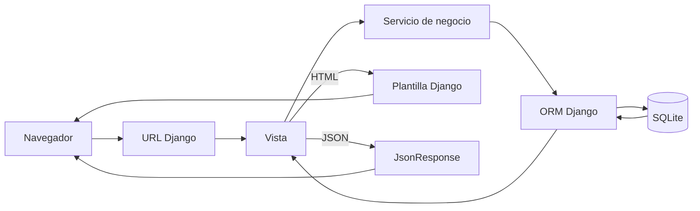

# FPCMerch — Primera Entrega

**Integrantes:** [Completar nombres del equipo]  
**Fecha:** 12 de octubre de 2026  
**Descripción:** Tienda académica demostrativa para consultar prendas y accesorios de fútbol y simular el proceso de compra.

## 2. Estructura de las páginas web

La aplicación está construida como un sitio multipágina Django. Las plantillas extienden `templates/base.html`, las operaciones del catálogo y las cuentas se procesan en vistas del servidor y las acciones interactivas del carrito/buscador consultan endpoints JSON propios.

### Páginas y rutas

| Página | Ruta | Plantilla | Vista | Login |
|---|---|---|---|---|
| Inicio | `/` | `home.html` | `apps.pages.views.home` | No |
| Catálogo | `/catalogo/` | `products/catalog.html` | `apps.products.views.catalog` | No |
| Producto | `/producto/<slug>/` | `products/detail.html` | `apps.products.views.product_detail` | No |
| Carrito | `/carrito/` | `cart/cart.html` | `apps.cart.views.cart_page` | No; cambia a BD tras entrar |
| Checkout | `/checkout/` | `orders/checkout.html` | `apps.orders.views.checkout` | Sí |
| Pedido / confirmación | `/pedido/<número>/` y `/pedido/<número>/confirmacion/` | `orders/detail.html` | `order_detail` / `confirmation` | Sí; dueño del pedido |
| Contacto | `/contacto/` | `contact/contact.html` | `apps.contact.views.contact` | No |
| Login | `/cuenta/entrar/` | `users/login.html` | `apps.users.views.login_view` | No |
| Registro | `/cuenta/registro/` | `users/register.html` | `apps.users.views.register_view` | No |
| Perfil | `/mi-cuenta/` | `users/profile.html` | `apps.users.views.profile_view` | Sí |
| Gestión productos | `/gestion/productos/` | `management/product_list.html` | `ProductManagementList` | Sí, personal (`is_staff`) |
| Crear/editar/borrar producto | `/gestion/productos/nuevo/`, `/<id>/editar/`, `/<id>/eliminar/` | `management/product_form.html`, `product_confirm_delete.html` | vistas genéricas CRUD | Sí, personal |
| Páginas informativas | `/informacion/<slug>/` | `pages/info.html` | `apps.pages.views.info_page` | No; seguimiento requiere sesión para ver la lista propia |
| Recuperar contraseña | `/cuenta/recuperar/…` | `registration/password_reset_*.html` | vistas de autenticación Django | No |
| Admin | `/admin/` | Plantillas de Django Admin | `django.contrib.admin` | Sí, staff |
| Errores | 400, 403, 404 y 500 | `errors/<código>.html` | manejadores de `fpcmerch/urls.py` | No |

Las páginas informativas ilustrativas enlazadas desde el footer son términos, devoluciones, guía de tallas, preguntas frecuentes y seguimiento. La consulta de seguimiento sólo muestra pedidos del usuario autenticado.

### Menús, formularios, tablas y acciones

La barra superior anuncia el envío gratis desde el umbral configurado. El navbar incluye marca/enlace de inicio, Inicio, Catálogo, categorías que se cargan desde `Category`, Contacto, buscador, acceso a cuenta, carrito y menú móvil. El footer incluye enlaces de catálogo y categorías, páginas de ayuda y datos de contacto de referencia. El drawer tiene overlay, cierre con botón/Escape, contador, líneas y total. No se usan enlaces `href="#"`.

| Formulario | Página | Campos y validación | Destino |
|---|---|---|---|
| Login | `/cuenta/entrar/` | correo y contraseña; respuesta genérica ante credenciales inválidas; recordar sesión | `authenticate`, backend de correo y fusión del carrito |
| Registro | `/cuenta/registro/` | nombre, apellido, correo único, contraseña, confirmación y aceptación de términos; validadores Django | `User` |
| Perfil | `/mi-cuenta/` | nombre, apellido, correo, teléfono y ciudad | actualización del usuario propio |
| Contacto | `/contacto/` | nombre, correo, asunto de cinco opciones y mensaje; errores visibles | `ContactMessage` |
| Filtros | `/catalogo/` | categoría, `precio_max`, talla, orden | parámetros GET procesados por el backend; conserva filtros al paginar |
| Buscador | navbar / `/catalogo/?q=` | consulta por nombre, descripción, SKU o categoría; sugerencias desde `/api/buscar/` | `filtered_products` / API |
| Checkout | `/checkout/` | dirección, ciudad, teléfono y medio de pago demo; validación de servidor | servicio transaccional de `apps.orders.services` |
| CRUD producto | `/gestion/productos/…` | ficha, precio no negativo, imagen válida ≤5 MB y formset de tallas/stock | `Product`, `ProductSize` |

Tablas visibles: el carrito lista producto, talla, precio, cantidad, subtotal y acción de quitar; el perfil lista pedidos; el detalle del pedido presenta sus líneas con precio unitario histórico; el panel lista imagen, producto, categoría, precio, stock agregado, destacado y acciones.

Acciones principales: flechas y puntos del carrusel; ver colección/catálogo; aplicar o limpiar filtros; agregar y cambiar cantidades del carrito; eliminar artículos; proceder al checkout; confirmar compra demo; guardar perfil; crear/editar/eliminar producto; enviar contacto; cerrar sesión por POST. El botón “Personalizar ahora” abre el formulario de contacto con asunto preseleccionado; no implementa un servicio de personalización.

Inicio: carrusel de tres escenas, tarjetas rápidas con conteos BD, productos destacados, promo de contacto y confianza. El catálogo tiene filtros responsivos y cuadrícula; el detalle tiene imagen, precio COP, conversión USD aproximada opcional, variantes y existencias. `includes/` contiene navbar, footer, drawer y tarjeta de producto; los mensajes de Django se muestran en `toastContainer`.

**Evidencias de interfaz:**

[CAPTURA PENDIENTE 2.1] Qué debe verse: inicio completo con carrusel, categorías, destacados y barra de URL visible.  
Guardar como: docs/evidencias/2_1_inicio.png

[CAPTURA PENDIENTE 2.2] Qué debe verse: catálogo con filtros reflejando categoría, precio y talla seleccionados.  
Guardar como: docs/evidencias/2_2_catalogo.png

[CAPTURA PENDIENTE 2.3] Qué debe verse: detalle de un producto, variantes/stock y precio COP; si el servicio está disponible, precio USD aproximado.  
Guardar como: docs/evidencias/2_3_detalle.png

[CAPTURA PENDIENTE 2.4] Qué debe verse: tabla del carrito con unidades y totales calculados.  
Guardar como: docs/evidencias/2_4_carrito.png

[CAPTURA PENDIENTE 2.5] Qué debe verse: formulario de login con correo, contraseña y enlace de recuperación.  
Guardar como: docs/evidencias/2_5_login.png

[CAPTURA PENDIENTE 2.6] Qué debe verse: perfil, información propia e historial de pedidos o estado vacío.  
Guardar como: docs/evidencias/2_6_perfil.png

[CAPTURA PENDIENTE 2.7] Qué debe verse: información de contacto y formulario con sus campos.  
Guardar como: docs/evidencias/2_7_contacto.png

[CAPTURA PENDIENTE 2.8] Qué debe verse: tabla del panel de gestión de productos con acciones CRUD.  
Guardar como: docs/evidencias/2_8_gestion.png

## 3. Frontend y Backend

**Frontend:** HTML5 en plantillas Django, CSS3 adaptable y JavaScript ES modules. Barlow Condensed y Barlow se cargan desde Google Fonts si hay conexión. Las plantillas renderizan el estado inicial del servidor. Los módulos añaden carrusel temporizado con pausa al pasar el cursor, menú móvil, toasts, drawer de carrito, filtro móvil, slider de precio, sugerencias con debounce, mostrar/ocultar contraseña y solicitudes `fetch` con token CSRF. Las validaciones visibles complementan la validación de Django; las reglas definitivas permanecen en el servidor.

**Backend:** Python y Django 5.2.17 LTS. Incluye modelos, admin, formularios, autenticación con correo, ORM SQLite, migraciones, consultas filtradas, paginación, servicios de carrito/stock/checkout, CRUD de personal, endpoints JSON, cliente HTTP de tasas de cambio, caché, logging y plantillas de error.

Los filtros y búsqueda se procesan desde parámetros GET; el carrito calcula precios desde productos de la base de datos; el checkout copia el precio unitario al pedido y actualiza existencias con `transaction.atomic` y `F()`. La comunicación persistente se realiza con el ORM sobre SQLite. La API propia devuelve JSON mediante `JsonResponse`; JavaScript no decide precios ni existencias.



## 4. Servidor web e implementación

En desarrollo se usa el servidor integrado de Django, que atiende la interfaz WSGI con `python manage.py runserver`. El proyecto se preparó para Windows/Visual Studio Code con Python 3.12.14 y Django 5.2.17. El puerto predeterminado de los comandos de entrega es 8000; puede cambiarse pasando otro puerto, por ejemplo `python manage.py runserver 8080`. En desarrollo, `runserver` sirve estáticos y medios.

Comandos desde PowerShell, con Python 3.11+ instalado:

```powershell
py -3 -m venv .venv
.\.venv\Scripts\Activate.ps1
python -m pip install --upgrade pip
python -m pip install -r requirements.txt
Copy-Item .env.example .env
python manage.py migrate
python manage.py seed_demo
python manage.py runserver 8000
```

Si PowerShell bloquea la activación, ejecuta `Set-ExecutionPolicy -Scope CurrentUser RemoteSigned` en una terminal de tu usuario y activa el entorno de nuevo; si no, omite ese ajuste. También puedes ejecutar `.\.venv\Scripts\python.exe manage.py …` sin activar el entorno. `migrate` crea las tablas; `seed_demo` añade datos demostrativos. Para producción se usaría un servidor WSGI como Gunicorn o Waitress detrás de Nginx/IIS, HTTPS, `DEBUG=False`, `ALLOWED_HOSTS` explícito, almacenamiento de medios apropiado y `collectstatic`. No forma parte de este despliegue académico.

[CAPTURA PENDIENTE 4.1] Qué debe verse: terminal con `runserver` activo y navegador en `http://127.0.0.1:8000/` con la página de inicio y URL visible.  
Guardar como: docs/evidencias/4_1_servidor.png

## 5. Implementación de modelos

| Modelo | Tabla | Propósito y relaciones |
|---|---|---|
| `User` | `users_user` | usuario `AbstractUser`, correo único de login, teléfono y ciudad |
| `Category` | `products_category` | fuente única de categorías, slug, icono y orden |
| `Product` | `products_product` | producto, SKU, precio, categoría, imagen y visibilidad |
| `ProductSize` | `products_productsize` | variante talla/stock; único por producto+talla |
| `Cart` | `cart_cart` | carrito persistido único por usuario autenticado |
| `CartItem` | `cart_cartitem` | variante y cantidad del carrito autenticado; visitante usa sesión |
| `Order` | `orders_order` | dueño, número, envío, estado y totales |
| `OrderItem` | `orders_orderitem` | producto protegido, talla, cantidad y precio congelado |
| `ContactMessage` | `contact_contactmessage` | formulario de contacto y marca de leído |

El código completo vigente de los modelos está en [`apps/users/models.py`](../apps/users/models.py), [`apps/products/models.py`](../apps/products/models.py), [`apps/cart/models.py`](../apps/cart/models.py), [`apps/orders/models.py`](../apps/orders/models.py) y [`apps/contact/models.py`](../apps/contact/models.py); se adjunta íntegro al final de este punto. Las migraciones iniciales reales están en `apps/*/migrations/0001_initial.py`. `users.0001_initial` se creó antes de las otras migraciones para fijar `AUTH_USER_MODEL` desde la primera.

Las columnas y tipos principales de SQLite son: claves `id` autoincrementales; email/textos como `varchar` o `text`; precio y totales como `decimal`; existencias y cantidades como `integer`; banderas como `bool`; marcas de tiempo como `datetime`; imágenes como ruta `varchar`. Restricciones: correo, slug, SKU y número de pedido únicos; precio y stock ≥ 0; cantidad de línea/cart ≥ 1; talla única por producto; variante única por carrito. Categoría usa `PROTECT`; las líneas históricas de pedido protegen el producto; artículos del carrito y variantes se eliminan en cascada según su propietario.

Para consultar el SQL generado: `python manage.py sqlmigrate users 0001`, `python manage.py sqlmigrate products 0001`, `python manage.py sqlmigrate cart 0001`, `python manage.py sqlmigrate orders 0001` o `.schema` desde la consola de SQLite. El diagrama relacional está en [`ER_diagrama.md`](ER_diagrama.md).

[CAPTURA PENDIENTE 5.1] Qué debe verse: tablas de productos, variantes, usuarios y pedidos en DB Browser for SQLite o `sqlite3 .schema`.  
Guardar como: docs/evidencias/5_1_esquema_bd.png

[CAPTURA PENDIENTE 5.2] Qué debe verse: productos/categorías/pedidos disponibles en Django Admin.  
Guardar como: docs/evidencias/5_2_admin_modelos.png

## 6. CRUD funcional de productos

El CRUD del panel está en `apps/products/views.py`, `forms.py`, `urls.py`, `admin.py` y `templates/management/`. La lista es una `ListView` paginada y con búsqueda; crear/editar son vistas genéricas basadas en formulario y `ProductSize` inline formset; borrar pide confirmación y captura `ProtectedError`, desactivando el producto si existen líneas de pedido. `StaffMixin` requiere sesión y `is_staff`. Todas las formas POST llevan CSRF y los datos se validan en servidor. La ficha pública sirve como operación de lectura por slug.

Rutas:

| CRUD | Ruta | Comportamiento |
|---|---|---|
| Read lista | `/gestion/productos/` | tabla, búsqueda y paginación |
| Read detalle | `/producto/<slug>/` | vista pública del producto |
| Create | `/gestion/productos/nuevo/` | ficha, imagen y tallas/stock |
| Update | `/gestion/productos/<id>/editar/` | actualiza producto y variantes |
| Delete | `/gestion/productos/<id>/eliminar/` | confirmación; desactiva si está protegido por pedidos |

`Product.category_id` referencia `Category`; `ProductSize.product_id` es uno a muchos; `OrderItem.product_id` mantiene referencia protegida. La tabla `products_product` guarda nombre, slug, SKU único, descripción, precio decimal no negativo, FK categoría, imagen, activo, destacado y fechas; las existencias viven en `products_productsize`, no en un campo de texto del producto.

Verifica cada operación en Admin, la página de gestión o con `python manage.py shell`:

```python
from apps.products.models import Product, ProductSize
Product.objects.filter(sku="CRUD-01").values("name", "price", "category__name")
ProductSize.objects.filter(product__sku="CRUD-01").values("size", "stock")
```

Secuencia de evidencias: listado; formulario de creación; producto creado en tabla y BD; edición; valores editados; confirmación de borrado; fila ausente o producto desactivado si lo protege un pedido.

[CAPTURA PENDIENTE 6.1] Qué debe verse: tabla del panel de gestión antes de crear el producto.  
Guardar como: docs/evidencias/6_1_crud_lista.png

[CAPTURA PENDIENTE 6.2] Qué debe verse: formulario de creación completo, incluida una variante con talla y stock.  
Guardar como: docs/evidencias/6_2_crud_crear_formulario.png

[CAPTURA PENDIENTE 6.3] Qué debe verse: producto creado en la lista y resultado de consulta en SQLite/shell.  
Guardar como: docs/evidencias/6_3_crud_creado_bd.png

[CAPTURA PENDIENTE 6.4] Qué debe verse: formulario del producto con un valor que se va a modificar.  
Guardar como: docs/evidencias/6_4_crud_editar_formulario.png

[CAPTURA PENDIENTE 6.5] Qué debe verse: resultado actualizado en lista y BD.  
Guardar como: docs/evidencias/6_5_crud_editado_bd.png

[CAPTURA PENDIENTE 6.6] Qué debe verse: confirmación antes de eliminar el producto.  
Guardar como: docs/evidencias/6_6_crud_confirmar_borrado.png

[CAPTURA PENDIENTE 6.7] Qué debe verse: verificación en BD tras borrar o desactivar por historial de pedido.  
Guardar como: docs/evidencias/6_7_crud_borrado_bd.png

## 7. Manejo de errores y excepciones

| Situación | Manejo implementado |
|---|---|
| Producto inexistente/inactivo | `get_object_or_404`, página 404 |
| Cantidad negativa, cero, no numérica o mayor al stock | validación de servicio; JSON 400 y toast |
| Stock agotado por compra simultánea | `transaction.atomic` y `UPDATE ... stock >= cantidad`; excepción fuerza rollback |
| Checkout sin artículos | mensaje y retorno al carrito |
| Credenciales incorrectas | mensaje genérico sin revelar si el correo existe |
| Correo duplicado/contraseñas diferentes/términos sin aceptar | errores en `RegistrationForm` |
| Contacto inválido | errores de campo; sólo guarda y confirma si es válido |
| Pedido ajeno | queryset filtrado por usuario y 404 |
| `/gestion/` sin login o sin staff | redirección al login o 403 |
| Archivo inválido o >5 MB | `ProductForm.clean_image` lo rechaza |
| Producto con pedido al borrarse | captura `ProtectedError`, desactiva producto y muestra aviso |
| API externa sin red/timeout/JSON inválido/tasa inválida | timeout de 3 s, `try/except`, logging, caché de seis horas y omisión del dato USD |
| Error interno | plantilla 500 y logging a consola/`logs/fpcmerch.log` |
| API POST sin CSRF o método inválido | middleware CSRF con JSON 403; JSON 405 para método incorrecto |

Las excepciones de dominio `InvalidQuantityError`, `OutOfStockError` y `EmptyCartError` están en `apps/cart/services.py`; el pedido se crea en una transacción en `apps/orders/services.py`. Las respuestas de error API siguen `{"ok": false, "error": "mensaje", "code": "out_of_stock"}`. `ProductSize` restringe stock no negativo; `OrderItem.product` utiliza `PROTECT`; sus relaciones se muestran en el diagrama ER.

Las pruebas automáticas se ejecutan con `python manage.py test`; al momento de documentar pasan 12 pruebas de carrito, fusión al login, checkout/rollback, privacidad, permisos, contacto, APIs, tasa externa simulada, registro y CRUD. Para repetir: `python manage.py test`.

[CAPTURA PENDIENTE 7.1] Qué debe verse: URL de producto inexistente y página 404 personalizada.  
Guardar como: docs/evidencias/7_1_error_404.png

[CAPTURA PENDIENTE 7.2] Qué debe verse: intento de agregar más unidades que el stock y toast JSON de error.  
Guardar como: docs/evidencias/7_2_stock_insuficiente.png

[CAPTURA PENDIENTE 7.3] Qué debe verse: errores de validación visibles en el formulario de contacto.  
Guardar como: docs/evidencias/7_3_formulario_invalido.png

[CAPTURA PENDIENTE 7.4] Qué debe verse: detalle de producto durante indisponibilidad de la API externa y mensaje alternativo.  
Guardar como: docs/evidencias/7_4_api_externa_caida.png

[CAPTURA PENDIENTE 7.5] Qué debe verse: salida de `python manage.py test` con resultado OK.  
Guardar como: docs/evidencias/7_5_tests_ok.png

## 8. Implementación y consumo de APIs

**¿Consume una API externa?** Sí: consulta tasas USD/COP desde el backend. **¿Tiene API propia?** Sí: endpoints JSON con `JsonResponse`. **¿Utiliza ambas?** Sí. La API pública de conversión consultada es `https://open.er-api.com/v6/latest/USD`; su respuesta verificada contiene `base_code: "USD"` y `rates.COP`. El valor aproximado se calcula como COP dividido por COP por USD. Se etiqueta como referencia; los pedidos siempre usan precio COP de la base local.

| Método | Endpoint | Función | Acceso |
|---|---|---|---|
| GET | `/api/productos/?categoria=&precio_max=&talla=&q=&page=` | lista paginada y filtrable | Público |
| GET | `/api/productos/<slug>/` | producto, variantes y stock | Público |
| GET | `/api/buscar/?q=` | hasta seis sugerencias | Público |
| GET | `/api/categorias/` | categorías con conteo actual | Público |
| GET | `/api/carrito/` | líneas e importes del carrito | Sesión |
| POST | `/api/carrito/agregar/` | agrega producto/variante/cantidad | Sesión + CSRF |
| POST | `/api/carrito/actualizar/` | fija cantidad de una variante | Sesión + CSRF |
| POST | `/api/carrito/eliminar/` | quita una variante | Sesión + CSRF |

Ejemplo: `GET http://127.0.0.1:8000/api/productos/` devuelve `{"ok":true,"count":89,"page":1,"pages":8,"results":[{"name":"…","slug":"…","sku":"…","price":"…","category":"…","url":"…","image":"…"}]}` cuando se cargaron los datos demo. Ejemplo de error al intentar exceder el stock: `{"ok":false,"error":"No hay existencias suficientes para esa cantidad.","code":"out_of_stock"}` con HTTP 400.

La implementación de la API propia está en `apps/api/views.py` y `urls.py`. `apps/api/external.py` usa Requests con timeout, valida el JSON, mantiene la tasa en la caché por seis horas y registra fallos. El navegador nunca solicita directamente la tasa de cambio. Sin conexión, la página de detalle sigue funcionando y omite la equivalencia en USD.

[CAPTURA PENDIENTE 8.1] Qué debe verse: endpoint `/api/productos/` abierto en el navegador con respuesta JSON.  
Guardar como: docs/evidencias/8_1_api_productos.png

[CAPTURA PENDIENTE 8.2] Qué debe verse: detalle de producto con precio COP y precio USD aproximado rotulado como referencia.  
Guardar como: docs/evidencias/8_2_api_usd.png

### Código íntegro de modelos (punto 5)


#### Usuario — `apps/users/models.py`

```python
from django.contrib.auth.models import AbstractUser, BaseUserManager
from django.db import models

class UserManager(BaseUserManager):
    use_in_migrations = True

    def _create_user(self, email, password, **extra_fields):
        if not email:
            raise ValueError("El correo es obligatorio.")
        user = self.model(email=self.normalize_email(email).lower(), **extra_fields)
        user.set_password(password)
        user.save(using=self._db)
        return user

    def create_user(self, email, password=None, **extra_fields):
        extra_fields.setdefault("is_staff", False)
        extra_fields.setdefault("is_superuser", False)
        return self._create_user(email, password, **extra_fields)

    def create_superuser(self, email, password=None, **extra_fields):
        extra_fields.setdefault("is_staff", True)
        extra_fields.setdefault("is_superuser", True)
        if extra_fields.get("is_staff") is not True or extra_fields.get("is_superuser") is not True:
            raise ValueError("El superusuario requiere is_staff e is_superuser.")
        return self._create_user(email, password, **extra_fields)

class User(AbstractUser):
    username = None
    email = models.EmailField(unique=True)
    telefono = models.CharField(max_length=30, blank=True)
    ciudad = models.CharField(max_length=100, blank=True)
    USERNAME_FIELD = "email"
    REQUIRED_FIELDS = []
    objects = UserManager()

    def __str__(self):
        return self.email
```


#### Categoría, producto y variantes — `apps/products/models.py`

```python
from django.core.validators import MinValueValidator
from django.db import models
from django.db.models import Q
from django.utils.text import slugify

class Category(models.Model):
    name = models.CharField(max_length=80, unique=True)
    slug = models.SlugField(unique=True)
    icon = models.CharField(max_length=40, default="⚽")
    order = models.PositiveSmallIntegerField(default=0)
    class Meta:
        ordering = ("order", "name")
        verbose_name_plural = "categories"
    def __str__(self): return self.name

class Product(models.Model):
    name = models.CharField(max_length=180)
    slug = models.SlugField(unique=True, blank=True)
    sku = models.CharField(max_length=40, unique=True)
    description = models.TextField()
    price = models.DecimalField(max_digits=12, decimal_places=2, validators=[MinValueValidator(0)])
    category = models.ForeignKey(Category, on_delete=models.PROTECT, related_name="products")
    image = models.ImageField(upload_to="products/", blank=True)
    is_active = models.BooleanField(default=True)
    is_featured = models.BooleanField(default=False)
    created_at = models.DateTimeField(auto_now_add=True)
    updated_at = models.DateTimeField(auto_now=True)
    class Meta:
        ordering = ("-created_at",)
        indexes = [models.Index(fields=("category", "is_active")), models.Index(fields=("name",)), models.Index(fields=("-created_at",))]
        constraints = [models.CheckConstraint(condition=Q(price__gte=0), name="product_price_nonnegative")]
    def save(self, *args, **kwargs):
        if not self.slug:
            base = slugify(self.name) or "producto"
            slug = base; suffix = 2
            while Product.objects.filter(slug=slug).exclude(pk=self.pk).exists():
                slug = f"{base}-{suffix}"; suffix += 1
            self.slug = slug
        super().save(*args, **kwargs)
    def __str__(self): return self.name
    @property
    def stock_total(self): return sum(v.stock for v in self.sizes.all())

class ProductSize(models.Model):
    product = models.ForeignKey(Product, on_delete=models.CASCADE, related_name="sizes")
    size = models.CharField(max_length=12, default="ÚNICA")
    stock = models.PositiveIntegerField(default=0)
    class Meta:
        ordering = ("size",)
        constraints = [models.UniqueConstraint(fields=("product", "size"), name="unique_product_size"), models.CheckConstraint(condition=Q(stock__gte=0), name="product_size_stock_nonnegative")]
    def __str__(self): return f"{self.product} · {self.size} ({self.stock})"
```


#### Carrito y línea — `apps/cart/models.py`

```python
from django.conf import settings
from django.core.validators import MinValueValidator
from django.db import models
from django.db.models import Q
from apps.products.models import ProductSize

class Cart(models.Model):
    user = models.OneToOneField(settings.AUTH_USER_MODEL, on_delete=models.CASCADE, related_name="cart")
    created_at = models.DateTimeField(auto_now_add=True)
    updated_at = models.DateTimeField(auto_now=True)
    def __str__(self): return f"Carrito de {self.user}"

class CartItem(models.Model):
    cart = models.ForeignKey(Cart, on_delete=models.CASCADE, related_name="items")
    variant = models.ForeignKey(ProductSize, on_delete=models.CASCADE, related_name="cart_items")
    quantity = models.PositiveIntegerField(default=1, validators=[MinValueValidator(1)])
    class Meta:
        constraints = [models.UniqueConstraint(fields=("cart", "variant"), name="unique_cart_variant"), models.CheckConstraint(condition=Q(quantity__gte=1), name="cart_item_quantity_positive")]
    def __str__(self): return f"{self.variant} × {self.quantity}"
```


#### Pedido y líneas — `apps/orders/models.py`

```python
from django.conf import settings
from django.core.validators import MinValueValidator
from django.db import models
from django.db.models import Q
from apps.products.models import Product

class Order(models.Model):
    class Status(models.TextChoices):
        PENDING = "pending", "Pendiente"
        PAID = "paid", "Pagado (demo)"
        SHIPPED = "shipped", "Enviado"
        DELIVERED = "delivered", "Entregado"
        CANCELLED = "cancelled", "Cancelado"
    user = models.ForeignKey(settings.AUTH_USER_MODEL, on_delete=models.PROTECT, related_name="orders")
    number = models.CharField(max_length=24, unique=True)
    status = models.CharField(max_length=16, choices=Status.choices, default=Status.PENDING)
    shipping_address = models.CharField(max_length=240)
    city = models.CharField(max_length=100)
    phone = models.CharField(max_length=30)
    payment_method = models.CharField(max_length=40, default="demo")
    subtotal = models.DecimalField(max_digits=12, decimal_places=2)
    shipping_cost = models.DecimalField(max_digits=12, decimal_places=2)
    total = models.DecimalField(max_digits=12, decimal_places=2)
    created_at = models.DateTimeField(auto_now_add=True)
    updated_at = models.DateTimeField(auto_now=True)
    class Meta:
        ordering = ("-created_at",)
        indexes = [models.Index(fields=("user", "-created_at")), models.Index(fields=("number",))]
    def __str__(self): return self.number

class OrderItem(models.Model):
    order = models.ForeignKey(Order, on_delete=models.CASCADE, related_name="items")
    product = models.ForeignKey(Product, on_delete=models.PROTECT, related_name="order_items")
    size = models.CharField(max_length=12, default="ÚNICA")
    quantity = models.PositiveIntegerField(validators=[MinValueValidator(1)])
    unit_price = models.DecimalField(max_digits=12, decimal_places=2)
    class Meta:
        constraints = [models.CheckConstraint(condition=Q(quantity__gte=1), name="order_item_quantity_positive")]
    def __str__(self): return f"{self.product} × {self.quantity}"
```


#### Mensaje de contacto — `apps/contact/models.py`

```python
from django.db import models

class ContactMessage(models.Model):
    SUBJECTS = [("order", "Seguimiento de pedido"), ("return", "Devolución o cambio"), ("product", "Información de producto"), ("personalization", "Personalización"), ("other", "Otro")]
    name = models.CharField(max_length=120)
    email = models.EmailField()
    subject = models.CharField(max_length=24, choices=SUBJECTS)
    message = models.TextField()
    created_at = models.DateTimeField(auto_now_add=True)
    is_read = models.BooleanField(default=False)
    class Meta: ordering = ("-created_at",)
    def __str__(self): return f"{self.name} · {self.get_subject_display()}"
```


### Código de CRUD, errores, APIs y pruebas


#### Formularios de cuentas — `apps/users/forms.py`

```python
from django import forms
from django.contrib.auth.forms import UserCreationForm
from django.contrib.auth.password_validation import validate_password
from .models import User

class RegistrationForm(UserCreationForm):
    email = forms.EmailField(label="Correo")
    first_name = forms.CharField(label="Nombre")
    last_name = forms.CharField(label="Apellido")
    accept_terms = forms.BooleanField(label="Acepto los términos y condiciones")

    class Meta:
        model = User
        fields = ("first_name", "last_name", "email")

    def clean_email(self):
        email = self.cleaned_data["email"].strip().lower()
        if User.objects.filter(email__iexact=email).exists():
            raise forms.ValidationError("Ya existe una cuenta con este correo.")
        return email

    def clean_password1(self):
        password = self.cleaned_data.get("password1")
        validate_password(password, self.instance)
        return password

class ProfileForm(forms.ModelForm):
    class Meta:
        model = User
        fields = ("first_name", "last_name", "email", "telefono", "ciudad")
        labels = {"first_name": "Nombre", "last_name": "Apellido", "email": "Correo", "telefono": "Teléfono", "ciudad": "Ciudad"}

class LoginForm(forms.Form):
    email = forms.EmailField(label="Correo")
    password = forms.CharField(label="Contraseña", widget=forms.PasswordInput)
    remember = forms.BooleanField(label="Recordarme", required=False)
```


#### Formularios del CRUD — `apps/products/forms.py`

```python
from django import forms
from django.forms import inlineformset_factory
from PIL import Image, UnidentifiedImageError
from .models import Product, ProductSize

class ProductForm(forms.ModelForm):
    class Meta:
        model = Product
        fields = ("name", "sku", "description", "price", "category", "image", "is_active", "is_featured")
        widgets = {"description": forms.Textarea(attrs={"rows": 5})}

    def clean_image(self):
        image = self.cleaned_data.get("image")
        if image and hasattr(image, "size"):
            if image.size > 5 * 1024 * 1024:
                raise forms.ValidationError("La imagen no puede superar 5 MB.")
            try:
                image.seek(0); Image.open(image).verify(); image.seek(0)
            except (UnidentifiedImageError, OSError, ValueError):
                raise forms.ValidationError("Sube una imagen válida.")
        return image

class SizeForm(forms.ModelForm):
    size = forms.CharField(label="Talla", max_length=12, required=False)
    stock = forms.IntegerField(label="Existencias", min_value=0, required=False)

    class Meta:
        model = ProductSize
        fields = ("size", "stock")

    def clean(self):
        cleaned = super().clean()
        if cleaned.get("DELETE"):
            return cleaned
        size = cleaned.get("size")
        stock = cleaned.get("stock")
        if size and stock is None:
            self.add_error("stock", "Indica el stock para esta talla.")
        elif stock is not None and not size:
            self.add_error("size", "Indica una talla o usa ÚNICA para variantes sin talla.")
        return cleaned

SizeFormSet = inlineformset_factory(Product, ProductSize, form=SizeForm, extra=1, min_num=1, validate_min=True, can_delete=True)
```


#### Vistas del CRUD — `apps/products/views.py`

```python
from django.contrib import messages
from django.contrib.auth.mixins import LoginRequiredMixin, UserPassesTestMixin
from django.core.paginator import Paginator
from django.db.models import Sum, ProtectedError
from django.shortcuts import get_object_or_404, redirect, render
from django.urls import reverse_lazy
from django.views.generic import CreateView, DeleteView, ListView, UpdateView
from .forms import ProductForm, SizeFormSet
from .models import Category, Product
from .services import filtered_products
from apps.api.external import usd_estimate

def catalog(request):
    page = Paginator(filtered_products(request.GET), 12).get_page(request.GET.get("page"))
    return render(request, "products/catalog.html", {"page_obj": page, "products": page.object_list, "filters": request.GET})

def product_detail(request, slug):
    product = get_object_or_404(Product.objects.prefetch_related("sizes"), slug=slug, is_active=True)
    return render(request, "products/detail.html", {"product": product, "usd_price": usd_estimate(product.price)})

class StaffMixin(LoginRequiredMixin, UserPassesTestMixin):
    def test_func(self): return self.request.user.is_staff

class ProductManagementList(StaffMixin, ListView):
    model = Product
    template_name = "management/product_list.html"
    context_object_name = "products"
    paginate_by = 15
    def get_queryset(self):
        query = self.request.GET.get("q", "").strip()
        qs = Product.objects.select_related("category").annotate(stock_sum=Sum("sizes__stock")).order_by("-created_at", "pk")
        return qs.filter(name__icontains=query) if query else qs

class ProductCreate(StaffMixin, CreateView):
    model = Product; form_class = ProductForm; template_name = "management/product_form.html"
    def get_context_data(self, **kwargs):
        ctx = super().get_context_data(**kwargs); ctx["size_formset"] = kwargs.get("size_formset") or SizeFormSet(self.request.POST or None, self.request.FILES or None); return ctx
    def form_valid(self, form):
        ctx = self.get_context_data(); formset = ctx["size_formset"]
        if not formset.is_valid(): return self.form_invalid(form)
        self.object = form.save(); formset.instance = self.object; formset.save(); messages.success(self.request, "Producto creado."); return redirect("products:manage")

class ProductUpdate(StaffMixin, UpdateView):
    model = Product; form_class = ProductForm; template_name = "management/product_form.html"
    def get_context_data(self, **kwargs):
        ctx = super().get_context_data(**kwargs); ctx["size_formset"] = kwargs.get("size_formset") or SizeFormSet(self.request.POST or None, self.request.FILES or None, instance=self.object); return ctx
    def form_valid(self, form):
        ctx = self.get_context_data(); formset = ctx["size_formset"]
        if not formset.is_valid(): return self.form_invalid(form)
        self.object = form.save(); formset.instance = self.object; formset.save(); messages.success(self.request, "Producto actualizado."); return redirect("products:manage")

class ProductDelete(StaffMixin, DeleteView):
    model = Product; template_name = "management/product_confirm_delete.html"; success_url = reverse_lazy("products:manage")
    def form_valid(self, form):
        try:
            self.object.delete()
            messages.success(self.request, "Producto eliminado.")
        except ProtectedError:
            self.object.is_active = False; self.object.save(update_fields=["is_active"])
            messages.warning(self.request, "El producto tiene pedidos y se desactivó en lugar de eliminarse.")
        return redirect(self.success_url)
```


#### Rutas del CRUD — `apps/products/urls.py`

```python
from django.urls import path
from . import views

app_name = "products"
urlpatterns = [
    path("catalogo/", views.catalog, name="catalog"),
    path("producto/<slug:slug>/", views.product_detail, name="detail"),
    path("gestion/productos/", views.ProductManagementList.as_view(), name="manage"),
    path("gestion/productos/nuevo/", views.ProductCreate.as_view(), name="create"),
    path("gestion/productos/<int:pk>/editar/", views.ProductUpdate.as_view(), name="update"),
    path("gestion/productos/<int:pk>/eliminar/", views.ProductDelete.as_view(), name="delete"),
]
```


#### Plantilla: lista — `templates/management/product_list.html`

```html


Gestión de productos · FPCMerch

<section class="page-heading container">
<span class="eyebrow">PANEL DE PERSONAL</span>
<h1>Gestión de productos</h1>
<a class="button button-dark" href="">Crear producto</a>
</section>
<section class="container">
<form method="get" class="management-search">
<label for="q">Buscar</label>
<input id="q" name="q" value="{{ request.GET.q }}">
<button class="button button-light">Buscar</button>
</form>
<div class="table-scroll">
<table class="data-table">
<thead>
<tr>
<th>Imagen</th>
<th>Nombre</th>
<th>Categoría</th>
<th>Precio</th>
<th>Stock</th>
<th>Destacado</th>
<th>Acciones</th>
</tr>
</thead>
<tbody>
<tr>
<td>

</td>
<td>{{ product.name }}</td>
<td>{{ product.category }}</td>
<td>{{ product.price|cop }}</td>
<td>{{ product.stock_sum|default:0 }}</td>
<td>{{ product.is_featured|yesno:'Sí,No' }}</td>
<td>
<a href="">Ver</a> · <a href="">Editar</a> · <a href="">Eliminar</a>
</td>
</tr>
<tr>
<td colspan="7">No hay productos.</td>
</tr>
</tbody>
</table>
</div>
<nav class="pagination">
<a href="?page={{ page_obj.previous_page_number }}">Anterior</a>
<span>{{ page_obj.number }}</span>
<a href="?page={{ page_obj.next_page_number }}">Siguiente</a>
</nav>
</section>

```


#### Plantilla: formulario — `templates/management/product_form.html`

```html


Editar
Crear
 producto · FPCMerch

<section class="page-heading container">
<span class="eyebrow">PANEL DE PERSONAL</span>
<h1>
Editar producto
Crear producto
</h1>
</section>
<form method="post" enctype="multipart/form-data" class="form-card container management-form">

{{ form.non_field_errors }}
<div class="form-field">
<label for="{{ field.id_for_label }}">{{ field.label }}</label>{{ field }}
<small class="field-error">{{ error }}</small>
</div>
<h2>Tallas y existencias</h2>{{ size_formset.management_form }}{{ size_formset.non_form_errors }}
<div class="size-form-row">
{{ size_form.non_field_errors }}
{{ hidden }}

<div class="form-field">
<label for="{{ field.id_for_label }}">{{ field.label }}</label>{{ field }}
<small class="field-error">{{ error }}</small>
</div>
</div>
<button class="button button-dark">Guardar producto</button>
<a href="">Cancelar</a>
</form>

```


#### Plantilla: confirmación — `templates/management/product_confirm_delete.html`

```html

Eliminar producto · FPCMerch

<section class="container form-card delete-card">
<h1>Eliminar producto</h1>
<p>¿Confirmas eliminar “{{ object.name }}”? Si está asociado a un pedido, se desactivará para conservar el historial.</p>
<form method="post">
<button class="button button-danger">Confirmar eliminación</button>
<a href="">Cancelar</a>
</form>
</section>

```


#### Servicios de carrito — `apps/cart/services.py`

```python
from decimal import Decimal
from django.db import transaction
from django.db.models import F
from apps.products.models import Product, ProductSize
from .models import Cart, CartItem

CART_KEY = "fpcmerch_cart"

class InvalidQuantityError(Exception): pass
class OutOfStockError(Exception): pass
class EmptyCartError(Exception): pass

def cart_data(request):
    if request.user.is_authenticated:
        cart, _ = Cart.objects.get_or_create(user=request.user)
        rows = CartItem.objects.filter(cart=cart, variant__product__is_active=True).select_related("variant__product", "variant__product__category")
        lines = [{"variant": row.variant, "product": row.variant.product, "size": row.variant.size, "quantity": row.quantity, "subtotal": row.variant.product.price * row.quantity} for row in rows]
        return {"lines": lines, "total": sum((line["subtotal"] for line in lines), Decimal("0")), "count": sum(line["quantity"] for line in lines)}
    raw = request.session.get(CART_KEY, {})
    lines = []; total = Decimal("0"); count = 0
    for key, quantity in raw.items():
        try:
            size_id = int(key); quantity = int(quantity)
            variant = ProductSize.objects.select_related("product", "product__category").get(pk=size_id, product__is_active=True)
        except (ValueError, TypeError, ProductSize.DoesNotExist): continue
        if quantity < 1: continue
        subtotal = variant.product.price * quantity
        lines.append({"variant": variant, "product": variant.product, "size": variant.size, "quantity": quantity, "subtotal": subtotal})
        total += subtotal; count += quantity
    return {"lines": lines, "total": total, "count": count}

def add_item(request, product_id, size_id, quantity):
    if not isinstance(quantity, int) or quantity < 1: raise InvalidQuantityError("La cantidad debe ser un entero mayor que cero.")
    product = Product.objects.get(pk=product_id, is_active=True)
    variant = ProductSize.objects.get(pk=size_id, product=product)
    if quantity > variant.stock: raise OutOfStockError("No hay existencias suficientes para esa cantidad.")
    if request.user.is_authenticated:
        cart, _ = Cart.objects.get_or_create(user=request.user)
        item, created = CartItem.objects.get_or_create(cart=cart, variant=variant, defaults={"quantity": 1})
        if created and quantity == 1: return
        if created: CartItem.objects.filter(pk=item.pk).update(quantity=quantity)
        else:
            changed = CartItem.objects.filter(pk=item.pk, quantity__lte=variant.stock - quantity).update(quantity=F("quantity") + quantity)
            if not changed:
                raise OutOfStockError("No hay existencias suficientes para esa cantidad.")
        item.refresh_from_db()
        if item.quantity > variant.stock:
            CartItem.objects.filter(pk=item.pk).delete()
            raise OutOfStockError("No hay existencias suficientes para esa cantidad.")
        return
    current = int(request.session.get(CART_KEY, {}).get(str(size_id), 0))
    if current + quantity > variant.stock: raise OutOfStockError("No hay existencias suficientes para esa cantidad.")
    cart = request.session.get(CART_KEY, {}); cart[str(size_id)] = current + quantity; request.session[CART_KEY] = cart; request.session.modified = True

def update_item(request, size_id, quantity):
    if not isinstance(quantity, int) or quantity < 1: raise InvalidQuantityError("La cantidad debe ser un entero mayor que cero.")
    variant = ProductSize.objects.get(pk=size_id, product__is_active=True)
    if quantity > variant.stock: raise OutOfStockError("No hay existencias suficientes para esa cantidad.")
    if request.user.is_authenticated:
        cart, _ = Cart.objects.get_or_create(user=request.user)
        CartItem.objects.update_or_create(cart=cart, variant=variant, defaults={"quantity": quantity})
        return
    cart = request.session.get(CART_KEY, {}); cart[str(size_id)] = quantity; request.session[CART_KEY] = cart; request.session.modified = True

def remove_item(request, size_id):
    if request.user.is_authenticated:
        CartItem.objects.filter(cart__user=request.user, variant_id=size_id).delete()
        return
    cart = request.session.get(CART_KEY, {}); cart.pop(str(size_id), None); request.session[CART_KEY] = cart; request.session.modified = True

def merge_session_cart(request, user):
    cart = request.session.get(CART_KEY, {})
    with transaction.atomic():
        user_cart, _ = Cart.objects.get_or_create(user=user)
        for size_key, quantity in cart.items():
            try:
                variant = ProductSize.objects.get(pk=int(size_key), product__is_active=True)
                if variant.stock < 1: continue
                current, created = CartItem.objects.get_or_create(cart=user_cart, variant=variant, defaults={"quantity": min(variant.stock, int(quantity))})
                if not created:
                    current.quantity = min(variant.stock, current.quantity + int(quantity)); current.save(update_fields=["quantity"])
            except (ValueError, TypeError, ProductSize.DoesNotExist): continue
    request.session.pop(CART_KEY, None)
```


#### Servicio transaccional de pedidos — `apps/orders/services.py`

```python
import uuid
from decimal import Decimal
from django.conf import settings
from django.db import transaction
from django.db.models import F
from apps.cart.services import CART_KEY, EmptyCartError, OutOfStockError, cart_data
from apps.cart.models import CartItem
from apps.products.models import ProductSize
from .models import Order, OrderItem

@transaction.atomic
def create_order(request, cleaned_data):
    summary = cart_data(request)
    if not summary["lines"]: raise EmptyCartError("El carrito está vacío.")
    subtotal = sum((line["subtotal"] for line in summary["lines"]), Decimal("0"))
    shipping = Decimal("0") if subtotal >= Decimal(str(settings.FREE_SHIPPING_THRESHOLD)) else Decimal(str(settings.SHIPPING_FLAT_RATE))
    order = Order.objects.create(user=request.user, number=f"FPC-{uuid.uuid4().hex[:10].upper()}", status=Order.Status.PAID,
        shipping_address=cleaned_data["shipping_address"], city=cleaned_data["city"], phone=cleaned_data["phone"],
        payment_method=cleaned_data["payment_method"], subtotal=subtotal, shipping_cost=shipping, total=subtotal + shipping)
    for line in summary["lines"]:
        variant = line["variant"]
        changed = ProductSize.objects.filter(pk=variant.pk, stock__gte=line["quantity"]).update(stock=F("stock") - line["quantity"])
        if not changed: raise OutOfStockError(f"Existencias insuficientes para {line['product'].name} ({line['size']}).")
        OrderItem.objects.create(order=order, product=line["product"], size=line["size"], quantity=line["quantity"], unit_price=line["product"].price)
    request.session[CART_KEY] = {}
    request.session.modified = True
    if request.user.is_authenticated:
        CartItem.objects.filter(cart__user=request.user).delete()
    return order
```


#### Vistas de contacto — `apps/contact/views.py`

```python
from django.shortcuts import redirect, render
from .forms import ContactForm

def contact(request):
    initial = {"subject": "personalization"} if request.GET.get("asunto") == "personalizacion" else None
    form = ContactForm(request.POST or None, initial=initial)
    if request.method == "POST" and form.is_valid():
        form.save()
        request.session["contact_message_saved"] = True
        return redirect("contact:contact")
    contact_success = request.session.pop("contact_message_saved", False)
    return render(request, "contact/contact.html", {"form": form, "contact_success": contact_success})
```


#### Manejadores de error — `apps/pages/views.py`

```python
from django.db.models import Count, Q
from django.shortcuts import render
from apps.products.models import Category, Product

def home(request):
    categories = Category.objects.annotate(product_count=Count("products", filter=Q(products__is_active=True)))
    featured = Product.objects.filter(is_active=True, is_featured=True).select_related("category")[:8]
    return render(request, "home.html", {"categories": categories, "featured_products": featured})

def info_page(request, slug):
    pages = {"terminos": ("Términos y condiciones", "Contenido ilustrativo: reemplaza estas condiciones por los términos revisados para tu operación."), "devoluciones": ("Devoluciones y cambios", "Contenido ilustrativo: confirma aquí plazos, condiciones y canales para cambios."), "guia-de-tallas": ("Guía de tallas", "Contenido ilustrativo: verifica la tabla de medidas de cada fabricante antes de comprar."), "preguntas-frecuentes": ("Preguntas frecuentes", "Contenido ilustrativo: agrega respuestas confirmadas sobre envíos, tallas y pedidos."), "seguimiento": ("Seguimiento de pedido", "Inicia sesión para consultar tus pedidos. Esta página no consulta pedidos de otras cuentas.")}
    title, body = pages.get(slug, ("Página informativa", "Contenido ilustrativo."))
    if slug == "seguimiento" and request.user.is_authenticated:
        from apps.orders.models import Order
        orders = Order.objects.filter(user=request.user)
    else: orders = []
    return render(request, "pages/info.html", {"title": title, "body": body, "orders": orders})

def bad_request(request, exception): return render(request, "errors/400.html", status=400)
def permission_denied(request, exception): return render(request, "errors/403.html", status=403)
def page_not_found(request, exception): return render(request, "errors/404.html", status=404)
def server_error(request): return render(request, "errors/500.html", status=500)
```


#### Configuración de error, logging y tienda — `fpcmerch/settings.py`

```python
"""Settings for the FPCMerch development project."""
import os
from pathlib import Path

BASE_DIR = Path(__file__).resolve().parent.parent
LOG_DIR = BASE_DIR / "logs"
LOG_DIR.mkdir(exist_ok=True)

env_file = BASE_DIR / ".env"
if env_file.exists():
    for line in env_file.read_text(encoding="utf-8").splitlines():
        line = line.strip()
        if line and not line.startswith("#") and "=" in line:
            key, value = line.split("=", 1)
            os.environ.setdefault(key.strip(), value.strip().strip('"').strip("'"))

def env_bool(name, default=False):
    return os.environ.get(name, str(default)).lower() in {"1", "true", "yes", "on"}

SECRET_KEY = os.environ.get("SECRET_KEY", "dev-only-change-this-key-before-deploying")
DEBUG = env_bool("DEBUG", True)
if not DEBUG and SECRET_KEY == "dev-only-change-this-key-before-deploying":
    raise RuntimeError("Define SECRET_KEY antes de iniciar con DEBUG=False.")
ALLOWED_HOSTS = [host.strip() for host in os.environ.get("ALLOWED_HOSTS", "127.0.0.1,localhost").split(",") if host.strip()]

INSTALLED_APPS = [
    "django.contrib.admin", "django.contrib.auth", "django.contrib.contenttypes",
    "django.contrib.sessions", "django.contrib.messages", "django.contrib.staticfiles",
    "apps.users.apps.UsersConfig", "apps.products.apps.ProductsConfig",
    "apps.cart.apps.CartConfig", "apps.orders.apps.OrdersConfig",
    "apps.contact.apps.ContactConfig", "apps.pages.apps.PagesConfig", "apps.api.apps.ApiConfig",
]
MIDDLEWARE = [
    "django.middleware.security.SecurityMiddleware", "django.contrib.sessions.middleware.SessionMiddleware",
    "django.middleware.locale.LocaleMiddleware", "django.middleware.common.CommonMiddleware",
    "django.middleware.csrf.CsrfViewMiddleware", "django.contrib.auth.middleware.AuthenticationMiddleware",
    "django.contrib.messages.middleware.MessageMiddleware", "django.middleware.clickjacking.XFrameOptionsMiddleware",
]
ROOT_URLCONF = "fpcmerch.urls"
TEMPLATES = [{
    "BACKEND": "django.template.backends.django.DjangoTemplates",
    "DIRS": [BASE_DIR / "templates"], "APP_DIRS": True,
    "OPTIONS": {"context_processors": [
        "django.template.context_processors.debug", "django.template.context_processors.request",
        "django.contrib.auth.context_processors.auth", "django.contrib.messages.context_processors.messages",
        "apps.products.context_processors.store_categories", "apps.cart.context_processors.cart_summary",
        "apps.pages.context_processors.store_info",
    ]},
}]
WSGI_APPLICATION = "fpcmerch.wsgi.application"
ASGI_APPLICATION = "fpcmerch.asgi.application"
DATABASES = {"default": {"ENGINE": "django.db.backends.sqlite3", "NAME": BASE_DIR / "db.sqlite3", "OPTIONS": {"timeout": 20}}}
AUTH_USER_MODEL = "users.User"
AUTHENTICATION_BACKENDS = ["apps.users.backends.EmailBackend"]
AUTH_PASSWORD_VALIDATORS = [
    {"NAME": "django.contrib.auth.password_validation.UserAttributeSimilarityValidator"},
    {"NAME": "django.contrib.auth.password_validation.MinimumLengthValidator"},
    {"NAME": "django.contrib.auth.password_validation.CommonPasswordValidator"},
    {"NAME": "django.contrib.auth.password_validation.NumericPasswordValidator"},
]
LANGUAGE_CODE = "es-co"
TIME_ZONE = "America/Bogota"
USE_I18N = True
USE_TZ = True
STATIC_URL = "static/"
STATICFILES_DIRS = [BASE_DIR / "static"]
STATIC_ROOT = BASE_DIR / "staticfiles"
MEDIA_URL = "media/"
MEDIA_ROOT = BASE_DIR / "media"
SESSION_COOKIE_SECURE = not DEBUG
CSRF_COOKIE_SECURE = not DEBUG
DEFAULT_AUTO_FIELD = "django.db.models.BigAutoField"
LOGIN_URL = "users:login"
CSRF_FAILURE_VIEW = "apps.api.views.csrf_failure"
LOGIN_REDIRECT_URL = "pages:home"
LOGOUT_REDIRECT_URL = "pages:home"
EMAIL_BACKEND = "django.core.mail.backends.console.EmailBackend"
DEFAULT_FROM_EMAIL = "FPCMerch <hola@fpcmerch.co>"
SESSION_COOKIE_HTTPONLY = True
CSRF_COOKIE_HTTPONLY = False
SESSION_COOKIE_AGE = 60 * 60 * 24 * 14
SESSION_SAVE_EVERY_REQUEST = False
FREE_SHIPPING_THRESHOLD = 150000
SHIPPING_FLAT_RATE = 12000
STORE_INFO = {
    "address": "Calle 72 #15-30, Bogotá",
    "phone": "+57 (601) 234-5678",
    "email": "hola@FPCMerch.co",
    "hours_week": "Lunes a sábado de 9:00 a. m. a 7:00 p. m.",
    "hours_sunday": "Domingos de 10:00 a. m. a 4:00 p. m.",
}
EXTERNAL_RATE_URL = "https://open.er-api.com/v6/latest/USD"
CACHES = {"default": {"BACKEND": "django.core.cache.backends.locmem.LocMemCache", "LOCATION": "fpcmerch-cache"}}
LOGGING = {
    "version": 1, "disable_existing_loggers": False,
    "formatters": {"standard": {"format": "{levelname} {asctime} {name}: {message}", "style": "{"}},
    "handlers": {
        "console": {"class": "logging.StreamHandler", "formatter": "standard"},
        "file": {"class": "logging.FileHandler", "filename": LOG_DIR / "fpcmerch.log", "formatter": "standard"},
    },
    "loggers": {"django": {"handlers": ["console", "file"], "level": "INFO"}, "apps": {"handlers": ["console", "file"], "level": "INFO", "propagate": False}},
}
```


#### Rutas del proyecto — `fpcmerch/urls.py`

```python
from django.conf import settings
from django.conf.urls.static import static
from django.contrib import admin
from django.urls import include, path
from django.contrib.auth import views as auth_views

handler400 = "apps.pages.views.bad_request"
handler403 = "apps.pages.views.permission_denied"
handler404 = "apps.pages.views.page_not_found"
handler500 = "apps.pages.views.server_error"

urlpatterns = [
    path("admin/", admin.site.urls),
    path("", include("apps.pages.urls")),
    path("", include("apps.products.urls")),
    path("", include("apps.users.urls")),
    path("", include("apps.cart.urls")),
    path("", include("apps.orders.urls")),
    path("", include("apps.contact.urls")),
    path("api/", include("apps.api.urls")),
    path("cuenta/recuperar/", auth_views.PasswordResetView.as_view(template_name="registration/password_reset_form.html", email_template_name="registration/password_reset_email.html", subject_template_name="registration/password_reset_subject.txt", success_url="/cuenta/recuperar/enviado/"), name="password_reset"),
    path("cuenta/recuperar/enviado/", auth_views.PasswordResetDoneView.as_view(template_name="registration/password_reset_done.html"), name="password_reset_done"),
    path("cuenta/recuperar/<uidb64>/<token>/", auth_views.PasswordResetConfirmView.as_view(template_name="registration/password_reset_confirm.html", success_url="/cuenta/recuperar/completo/"), name="password_reset_confirm"),
    path("cuenta/recuperar/completo/", auth_views.PasswordResetCompleteView.as_view(template_name="registration/password_reset_complete.html"), name="password_reset_complete"),
    path("cuenta/", include("django.contrib.auth.urls")),
]

if settings.DEBUG:
    urlpatterns += static(settings.MEDIA_URL, document_root=settings.MEDIA_ROOT)
```


#### Plantilla de error 400 — `templates/errors/400.html`

```html

Solicitud incorrecta · FPCMerch

<section class="container info-card">
<span class="eyebrow">ERROR 400</span>
<h1>Solicitud incorrecta</h1>
<p>Revisa la información enviada e inténtalo de nuevo.</p>
<a class="button button-dark" href="">Volver al inicio</a>
</section>

```


#### Plantilla de error 403 — `templates/errors/403.html`

```html

Acceso denegado · FPCMerch

<section class="container info-card">
<span class="eyebrow">ERROR 403</span>
<h1>No tienes permiso</h1>
<p>Esta sección está disponible para personal autorizado.</p>
<a class="button button-dark" href="">Volver al inicio</a>
</section>

```


#### Plantilla de error 404 — `templates/errors/404.html`

```html

No encontrado · FPCMerch

<section class="container info-card">
<span class="eyebrow">ERROR 404</span>
<h1>Este balón salió de la cancha</h1>
<p>No encontramos la página o el producto solicitado.</p>
<a class="button button-dark" href="">Volver al inicio</a>
</section>

```


#### Plantilla de error 500 — `templates/errors/500.html`

```html

Error del servidor · FPCMerch

<section class="container info-card">
<span class="eyebrow">ERROR 500</span>
<h1>Estamos revisando la jugada</h1>
<p>Ocurrió un error interno. Inténtalo de nuevo más tarde.</p>
<a class="button button-dark" href="">Volver al inicio</a>
</section>

```


#### API propia — `apps/api/views.py`

```python
import json
from functools import wraps
from django.core.paginator import Paginator
from django.db.models import Count, Q
from django.http import JsonResponse
from django.shortcuts import get_object_or_404
from apps.cart.services import InvalidQuantityError, OutOfStockError, add_item, cart_data, remove_item, update_item
from apps.products.models import Category, Product, ProductSize
from apps.products.services import filtered_products

def error(message, code, status=400):
    return JsonResponse({"ok": False, "error": message, "code": code}, status=status)

def csrf_failure(request, reason=""):
    if request.path.startswith("/api/"):
        return error("La verificación de seguridad falló. Recarga la página e inténtalo de nuevo.", "csrf_failed", 403)
    from django.shortcuts import render
    return render(request, "errors/403.html", status=403)

def json_method(method):
    def decorate(view):
        @wraps(view)
        def wrapped(request, *args, **kwargs):
            if request.method != method:
                return error("Método HTTP no permitido.", "method_not_allowed", 405)
            return view(request, *args, **kwargs)
        return wrapped
    return decorate

def product_json(product):
    return {"name": product.name, "slug": product.slug, "sku": product.sku, "price": str(product.price), "category": product.category.name, "url": f"/producto/{product.slug}/", "image": product.image.url if product.image else ""}

@json_method("GET")
def products_api(request):
    page = Paginator(filtered_products(request.GET), 12).get_page(request.GET.get("page"))
    return JsonResponse({"ok": True, "count": page.paginator.count, "page": page.number, "pages": page.paginator.num_pages, "results": [product_json(p) for p in page.object_list]})

@json_method("GET")
def product_detail_api(request, slug):
    product = get_object_or_404(Product.objects.prefetch_related("sizes"), slug=slug, is_active=True)
    data = product_json(product)
    data["description"] = product.description
    data["sizes"] = [{"id": v.pk, "size": v.size, "stock": v.stock} for v in product.sizes.all()]
    return JsonResponse({"ok": True, "product": data})

@json_method("GET")
def search_api(request):
    query = (request.GET.get("q") or "").strip()
    if len(query) < 2: return JsonResponse({"ok": True, "results": []})
    return JsonResponse({"ok": True, "results": [product_json(p) for p in filtered_products({"q": query})[:6]]})

@json_method("GET")
def categories_api(request):
    categories = Category.objects.annotate(product_count=Count("products", filter=Q(products__is_active=True)))
    return JsonResponse({"ok": True, "results": [{"name": c.name, "slug": c.slug, "count": c.product_count} for c in categories]})

def cart_json(request):
    data = cart_data(request)
    return JsonResponse({"ok": True, "count": data["count"], "total": str(data["total"]), "items": [{"product": l["product"].name, "size": l["size"], "quantity": l["quantity"], "price": str(l["product"].price), "subtotal": str(l["subtotal"]), "variant_id": l["variant"].pk} for l in data["lines"]]})

@json_method("GET")
def cart_api(request): return cart_json(request)

def payload(request):
    try: return json.loads(request.body or "{}")
    except (json.JSONDecodeError, UnicodeDecodeError): raise ValueError("El cuerpo JSON no es válido.")

@json_method("POST")
def cart_add_api(request):
    try:
        data = payload(request)
        add_item(request, int(data["product_id"]), int(data["size_id"]), int(data.get("quantity", 1)))
    except ValueError as exc: return error(str(exc) or "Cantidad inválida.", "invalid_quantity")
    except KeyError: return error("Faltan campos requeridos.", "invalid_request")
    except OutOfStockError as exc: return error(str(exc), "out_of_stock")
    except InvalidQuantityError as exc: return error(str(exc), "invalid_quantity")
    except (Product.DoesNotExist, ProductSize.DoesNotExist): return error("Producto o talla no disponible.", "not_found", 404)
    return cart_json(request)

@json_method("POST")
def cart_update_api(request):
    try:
        data = payload(request)
        update_item(request, int(data["size_id"]), int(data["quantity"]))
    except (ValueError, KeyError) as exc: return error(str(exc) or "Cantidad o talla inválida.", "invalid_quantity")
    except OutOfStockError as exc: return error(str(exc), "out_of_stock")
    except InvalidQuantityError as exc: return error(str(exc), "invalid_quantity")
    except ProductSize.DoesNotExist: return error("La talla no está disponible.", "not_found", 404)
    return cart_json(request)

@json_method("POST")
def cart_remove_api(request):
    try:
        data = payload(request)
        remove_item(request, int(data["size_id"]))
    except (ValueError, KeyError) as exc: return error(str(exc) or "Talla inválida.", "invalid_request")
    return cart_json(request)
```


#### Rutas API — `apps/api/urls.py`

```python
from django.urls import path
from . import views

app_name = "api"
urlpatterns = [path("productos/", views.products_api, name="products"), path("productos/<slug:slug>/", views.product_detail_api, name="product-detail"), path("buscar/", views.search_api, name="search"), path("categorias/", views.categories_api, name="categories"), path("carrito/", views.cart_api, name="cart"), path("carrito/agregar/", views.cart_add_api, name="cart-add"), path("carrito/actualizar/", views.cart_update_api, name="cart-update"), path("carrito/eliminar/", views.cart_remove_api, name="cart-remove")]
```


#### Cliente de tasa externa — `apps/api/external.py`

```python
import logging
from decimal import Decimal
import requests
from django.conf import settings
from django.core.cache import cache

logger = logging.getLogger(__name__)

def usd_estimate(cop_price):
    rate = cache.get("usd_cop_rate")
    if rate is None:
        try:
            response = requests.get(settings.EXTERNAL_RATE_URL, timeout=3)
            response.raise_for_status()
            payload = response.json()
            rate = Decimal(str(payload["rates"]["COP"]))
            if rate <= 0: raise ValueError("Invalid exchange rate")
            cache.set("usd_cop_rate", rate, 21600)
        except (requests.RequestException, ValueError, KeyError, TypeError) as exc:
            logger.warning("No se pudo actualizar la tasa USD/COP: %s", exc)
            return None
    return (Decimal(str(cop_price)) / rate).quantize(Decimal("0.01"))
```


#### Pruebas automáticas — `apps/products/tests/test_store.py`

```python
from decimal import Decimal
from unittest.mock import patch
import requests
from django.test import TestCase
from django.urls import reverse
from apps.api.external import usd_estimate
from apps.cart.models import Cart, CartItem
from apps.cart.services import CART_KEY, OutOfStockError
from apps.contact.models import ContactMessage
from apps.orders.models import Order, OrderItem
from apps.orders.services import create_order
from apps.products.models import Category, Product, ProductSize
from apps.users.models import User

class StoreTestCase(TestCase):
    def setUp(self):
        self.user = User.objects.create_user(email="user@example.test", password="StrongPass2026!", first_name="Ana")
        self.category = Category.objects.create(name="Camisetas", slug="camisetas")
        self.product = Product.objects.create(name="Camiseta Local", sku="TEST-01", description="Prenda de prueba", price=Decimal("85000"), category=self.category)
        self.size = ProductSize.objects.create(product=self.product, size="M", stock=5)

    def test_cart_session_add_update_remove_and_stock_limit(self):
        response = self.client.post(reverse("api:cart-add"), data={"product_id": self.product.pk, "size_id": self.size.pk, "quantity": 2}, content_type="application/json")
        self.assertEqual(response.status_code, 200)
        self.assertEqual(response.json()["count"], 2)
        over = self.client.post(reverse("api:cart-add"), data={"product_id": self.product.pk, "size_id": self.size.pk, "quantity": 9}, content_type="application/json")
        self.assertEqual(over.status_code, 400)
        self.assertEqual(over.json()["code"], "out_of_stock")
        self.client.post(reverse("api:cart-update"), data={"size_id": self.size.pk, "quantity": 3}, content_type="application/json")
        self.assertEqual(self.client.get(reverse("api:cart")).json()["count"], 3)
        self.client.post(reverse("api:cart-remove"), data={"size_id": self.size.pk}, content_type="application/json")
        self.assertEqual(self.client.get(reverse("api:cart")).json()["count"], 0)

    def test_login_uses_email_and_merges_session_cart(self):
        session = self.client.session
        session[CART_KEY] = {str(self.size.pk): 2}
        session.save()
        response = self.client.post(reverse("users:login"), {"email": self.user.email, "password": "StrongPass2026!", "remember": "on"})
        self.assertEqual(response.status_code, 302)
        self.assertEqual(CartItem.objects.get(cart__user=self.user, variant=self.size).quantity, 2)
        self.assertNotIn(CART_KEY, self.client.session)

    def test_checkout_decrements_stock_and_copies_price(self):
        self.client.force_login(self.user)
        cart, _ = Cart.objects.get_or_create(user=self.user)
        CartItem.objects.create(cart=cart, variant=self.size, quantity=2)
        request = self._request_with_session()
        order = create_order(request, {"shipping_address": "Calle 1 #2-3", "city": "Bogotá", "phone": "3000000000", "payment_method": "demo_card"})
        self.size.refresh_from_db()
        self.assertEqual(self.size.stock, 3)
        self.assertEqual(order.items.get().unit_price, Decimal("85000"))
        self.assertEqual(order.shipping_cost, Decimal("0"))
        self.assertFalse(CartItem.objects.filter(cart=cart).exists())

    def test_checkout_rolls_back_all_changes_on_simultaneous_stock_loss(self):
        second = Product.objects.create(name="Short Stock", sku="TEST-02", description="Prueba", price=Decimal("50000"), category=self.category)
        unavailable = ProductSize.objects.create(product=second, size="M", stock=0)
        cart, _ = Cart.objects.get_or_create(user=self.user)
        CartItem.objects.create(cart=cart, variant=self.size, quantity=2)
        CartItem.objects.create(cart=cart, variant=unavailable, quantity=1)
        request = self._request_with_session()
        with self.assertRaises(OutOfStockError):
            create_order(request, {"shipping_address": "Calle 1", "city": "Bogotá", "phone": "3000", "payment_method": "demo_card"})
        self.size.refresh_from_db()
        self.assertEqual(self.size.stock, 5)
        self.assertEqual(Order.objects.count(), 0)

    def test_owner_privacy_and_management_access(self):
        other = User.objects.create_user(email="other@example.test", password="StrongPass2026!")
        order = Order.objects.create(user=other, number="FPC-PRIVACY", shipping_address="Calle 1", city="Bogotá", phone="3000", subtotal=10, shipping_cost=0, total=10)
        self.client.force_login(self.user)
        self.assertEqual(self.client.get(reverse("orders:detail", args=[order.number])).status_code, 404)
        self.client.logout()
        self.assertEqual(self.client.get(reverse("products:manage")).status_code, 302)
        staff = User.objects.create_user(email="staff@example.test", password="StrongPass2026!", is_staff=True)
        self.client.force_login(staff)
        self.assertEqual(self.client.get(reverse("products:manage")).status_code, 200)

    def test_delete_protected_product_deactivates_it(self):
        staff = User.objects.create_user(email="manager@example.test", password="StrongPass2026!", is_staff=True)
        order = Order.objects.create(user=self.user, number="FPC-KEEP", shipping_address="Calle 1", city="Bogotá", phone="3000", subtotal=85000, shipping_cost=0, total=85000)
        OrderItem.objects.create(order=order, product=self.product, size=self.size.size, quantity=1, unit_price=self.product.price)
        self.client.force_login(staff)
        response = self.client.post(reverse("products:delete", args=[self.product.pk]))
        self.assertEqual(response.status_code, 302)
        self.product.refresh_from_db()
        self.assertFalse(self.product.is_active)

    def test_contact_form_saves_only_valid_message(self):
        response = self.client.post(reverse("contact:contact"), {"name": "Ana", "email": "bad", "subject": "other", "message": "Hola"})
        self.assertEqual(response.status_code, 200)
        self.assertEqual(ContactMessage.objects.count(), 0)
        success = self.client.post(reverse("contact:contact"), {"name": "Ana", "email": "ana@example.test", "subject": "other", "message": "Hola"})
        self.assertEqual(success.status_code, 302)
        self.assertEqual(ContactMessage.objects.count(), 1)
        followed = self.client.get(success.url)
        self.assertContains(followed, 'id="contactSuccess"')

    def test_json_api_list_and_external_rate_fallback(self):
        self.assertTrue(self.client.get(reverse("api:products")).json()["ok"])
        self.assertEqual(self.client.post(reverse("api:products")).status_code, 405)
        with patch("apps.api.external.requests.get", side_effect=requests.Timeout("offline")):
            self.assertIsNone(usd_estimate(Decimal("85000")))

    def test_store_pages_render(self):
        with patch("apps.products.views.usd_estimate", return_value=Decimal("26.58")):
            self.assertEqual(self.client.get(reverse("pages:home")).status_code, 200)
            self.assertEqual(self.client.get(reverse("products:catalog")).status_code, 200)
            self.assertEqual(self.client.get(reverse("products:detail", args=[self.product.slug])).status_code, 200)
        self.assertEqual(self.client.get(reverse("cart:view")).status_code, 200)
        self.assertEqual(self.client.get(reverse("pages:info", args=["terminos"])).status_code, 200)

    def test_registration_validates_and_creates_email_user(self):
        response = self.client.post(reverse("users:register"), {
            "first_name": "Luis", "last_name": "Pérez", "email": "luis@example.test",
            "password1": "StrongReg2026!", "password2": "StrongReg2026!", "accept_terms": "on",
        })
        self.assertEqual(response.status_code, 302)
        self.assertTrue(User.objects.filter(email="luis@example.test").exists())
        self.assertNotEqual(User.objects.get(email="luis@example.test").password, "StrongReg2026!")

    def test_product_management_create_and_delete(self):
        staff = User.objects.create_user(email="staff@example.test", password="StrongPass2026!", is_staff=True)
        self.client.force_login(staff)
        created = self.client.post(reverse("products:create"), {
            "name": "Nueva camiseta", "sku": "CRUD-01", "description": "Descripción", "price": "50000", "category": self.category.pk, "is_active": "on",
            "sizes-TOTAL_FORMS": "1", "sizes-INITIAL_FORMS": "0", "sizes-MIN_NUM_FORMS": "0", "sizes-MAX_NUM_FORMS": "1000", "sizes-0-size": "L", "sizes-0-stock": "4",
        })
        self.assertEqual(created.status_code, 302)
        self.assertEqual(self.client.get(reverse("products:create")).status_code, 200)
        product = Product.objects.get(sku="CRUD-01")
        self.assertTrue(ProductSize.objects.filter(product=product, size="L", stock=4).exists())
        variant = ProductSize.objects.get(product=product, size="L")
        updated = self.client.post(reverse("products:update", args=[product.pk]), {
            "name": "Nueva camiseta editada", "sku": "CRUD-01", "description": "Descripción actualizada", "price": "62000", "category": self.category.pk, "is_active": "on",
            "sizes-TOTAL_FORMS": "4", "sizes-INITIAL_FORMS": "1", "sizes-MIN_NUM_FORMS": "0", "sizes-MAX_NUM_FORMS": "1000",
            "sizes-0-id": variant.pk, "sizes-0-product": product.pk, "sizes-0-size": "L", "sizes-0-stock": "7",
        })
        self.assertEqual(updated.status_code, 302)
        product.refresh_from_db(); variant.refresh_from_db()
        self.assertEqual(product.price, Decimal("62000"))
        self.assertEqual(variant.stock, 7)
        removed = self.client.post(reverse("products:delete", args=[product.pk]))
        self.assertEqual(removed.status_code, 302)
        self.assertFalse(Product.objects.filter(pk=product.pk).exists())

    def test_account_order_and_password_reset_templates_render(self):
        self.assertEqual(self.client.get(reverse("users:login")).status_code, 200)
        self.assertEqual(self.client.get(reverse("users:register")).status_code, 200)
        self.assertEqual(self.client.get(reverse("password_reset")).status_code, 200)
        self.client.force_login(self.user)
        self.assertEqual(self.client.get(reverse("users:profile")).status_code, 200)
        cart, _ = Cart.objects.get_or_create(user=self.user)
        CartItem.objects.create(cart=cart, variant=self.size, quantity=1)
        self.assertEqual(self.client.get(reverse("orders:checkout")).status_code, 200)
        self.client.logout()
        admin = User.objects.create_superuser(email="admin@example.test", password="StrongPass2026!")
        self.client.force_login(admin)
        self.assertEqual(self.client.get("/admin/users/user/add/").status_code, 200)

    def _request_with_session(self):
        from django.test import RequestFactory
        from django.contrib.sessions.middleware import SessionMiddleware
        request = RequestFactory().post("/checkout/")
        middleware = SessionMiddleware(lambda req: None); middleware.process_request(request); request.session.save()
        request.user = self.user
        return request
```

## Lista de comprobación manual

1. Navega entre Inicio, Catálogo, Contacto y enlaces del footer; verifica que no haya destinos vacíos.
2. Usa flechas y puntos del carrusel, espera el avance automático y confirma que se pausa al pasar el cursor.
3. Abre las seis categorías y compara sus conteos con los productos activos.
4. Busca por nombre, SKU y categoría; confirma que aparecen sugerencias y que Enter abre resultados.
5. Aplica categoría, precio, talla, orden y búsqueda en conjunto; cambia de página y comprueba que los filtros se mantienen.
6. Abre un detalle; verifica variantes, existencias, COP y la disponibilidad opcional del cálculo USD.
7. Registra una cuenta, cierra sesión mediante POST y vuelve a entrar con correo y contraseña.
8. Añade productos como visitante, entra con una cuenta y confirma que las cantidades se combinan sin superar stock.
9. Cambia/elimina cantidades; intenta exceder stock y confirma que aparece el error sin cambiar el carrito.
10. Completa el checkout demo con una cuenta; confirma estado del pedido, precio histórico y descuento del stock. Prueba envío gratuito sobre `$150.000 COP` y tarifa de ejemplo debajo.
11. Edita el perfil propio y comprueba que la cuenta no puede abrir el pedido de otra persona.
12. Envía contacto válido e inválido; verifica que sólo el primero queda guardado y confirmado.
13. Prueba el CRUD como staff: listar, crear con tallas, editar, borrar sin pedido y desactivar cuando exista historial; confirma que una cuenta normal no entra.
14. Abre una ruta desconocida, manda un método HTTP incorrecto y prueba API sin CSRF para observar 404/405/403.
15. Consulta API de productos, categorías, búsqueda y carrito; revisa Django Admin, contraseña olvidada en la consola y privacidad de pedidos.

## Conclusiones, limitaciones e índice de capturas

El proyecto contiene una tienda Django funcional con usuarios, catálogo, carrito, checkout simulado, pedidos, CRUD, administración, manejo de errores, API propia, consulta externa, pruebas y configuración local. Son ilustrativos los productos demo, imágenes, precios, información de contacto/políticas y las afirmaciones promocionales de reseñas, entregas, pago y devoluciones. El pago no se procesa, no hay integración de pasarela, el servidor incluido es de desarrollo y las capturas aún deben tomarse y pegarse en `docs/evidencias/`.

### Índice de capturas pendientes y pasos

1. Ejecuta migraciones/datos y arranca el servidor: `python manage.py migrate`, `python manage.py seed_demo`, `python manage.py runserver 8000`.
2. Abre `http://127.0.0.1:8000/`, navega a cada ruta y captura la evidencia indicada arriba con la URL visible cuando aplique.
3. Para carrito, checkout, perfil y gestión, inicia sesión primero con cliente demo o una cuenta propia; para CRUD inicia sesión como `is_staff`.
4. Para CRUD, crea un producto de prueba, captura listado/formulario/resultado, edita y captura; luego confirma el borrado y verifica la BD. Si el producto tiene un pedido asociado, documenta que queda desactivado.
5. Para error de stock, crea una cantidad baja y envía una cantidad mayor; para caída externa detén la red o simula el timeout en entorno local. No se debe registrar ningún secreto en las capturas.
6. Para `7_5_tests_ok.png`, corre `python manage.py test`. Guarda cada imagen en la ruta `docs/evidencias/...` listada junto a su marcador y reemplaza el marcador por ``.

| Código | Archivo |
|---|---|
| 2.1–2.8 | `2_1_inicio.png`, `2_2_catalogo.png`, `2_3_detalle.png`, `2_4_carrito.png`, `2_5_login.png`, `2_6_perfil.png`, `2_7_contacto.png`, `2_8_gestion.png` |
| 4.1 | `4_1_servidor.png` |
| 5.1–5.2 | `5_1_esquema_bd.png`, `5_2_admin_modelos.png` |
| 6.1–6.7 | `6_1_crud_lista.png`, `6_2_crud_crear_formulario.png`, `6_3_crud_creado_bd.png`, `6_4_crud_editar_formulario.png`, `6_5_crud_editado_bd.png`, `6_6_crud_confirmar_borrado.png`, `6_7_crud_borrado_bd.png` |
| 7.1–7.5 | `7_1_error_404.png`, `7_2_stock_insuficiente.png`, `7_3_formulario_invalido.png`, `7_4_api_externa_caida.png`, `7_5_tests_ok.png` |
| 8.1–8.2 | `8_1_api_productos.png`, `8_2_api_usd.png` |
